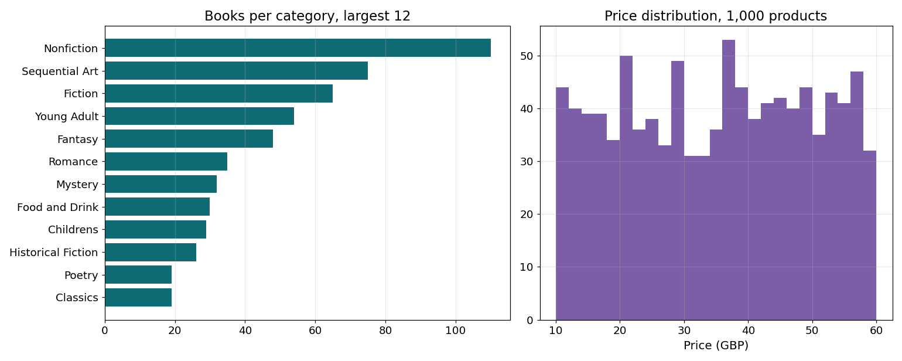

# Web Data Pipeline

A scraper is easy to write and hard to keep running. This pipeline is built for the second part: it survives failures, keeps bad records out of your data, resumes after a stop and tells you what changed since the last run.



## How it behaves

- **Polite by default:** reads robots.txt, spaces requests evenly and honours `Retry-After`.
- **Retries only what's worth retrying:** timeouts, 429 and 5xx get backoff with jitter. A 404 isn't retried.
- **Resumable:** the queue lives in SQLite, so a stopped run continues where it left off.
- **Incremental:** repeat runs use ETag and Last-Modified, so unchanged pages aren't downloaded again. An unchanged list page still leads to its items, because any of those may have changed.
- **Validated:** each record goes through a schema. A page that fails goes to a rejects table with the reason, and never into your data.
- **Change history:** price, stock and title changes are logged with the old and new values.
- **Quality report:** missing fields, duplicates, value ranges, failed and rejected pages.

## Measured

A real crawl of [books.toscrape.com](https://books.toscrape.com), a public site made for scraping practice, at 6 requests per second.

| | First run | Repeat run |
|---|---|---|
| Requests | 1,050 | 1,050 |
| Unchanged pages (not downloaded again) | 0 | 1,050 |
| Products stored | 1,000 | 1,000 |
| Failed or rejected pages | 0 | 0 |

The quality report found 2 products with no description and 1 duplicated title, which is what the site really contains. 14 tests use a fake site that returns errors, rate limits, broken pages and changed prices: `pytest`.

## Use

```bash
pip install -r requirements.txt
python pipeline.py https://books.toscrape.com/catalogue/page-1.html --db catalogue.sqlite
```

Output is SQLite plus a CSV. Parsers are two small functions, so a new site means changing those and the schema.

## Limits and responsibility

This is built for sites you're allowed to collect from. Check the terms of the site and any rules on personal data before running it. It has no tools for getting around logins, blocks or CAPTCHAs, and I don't build those. Pages rendered by JavaScript need a browser step added.
